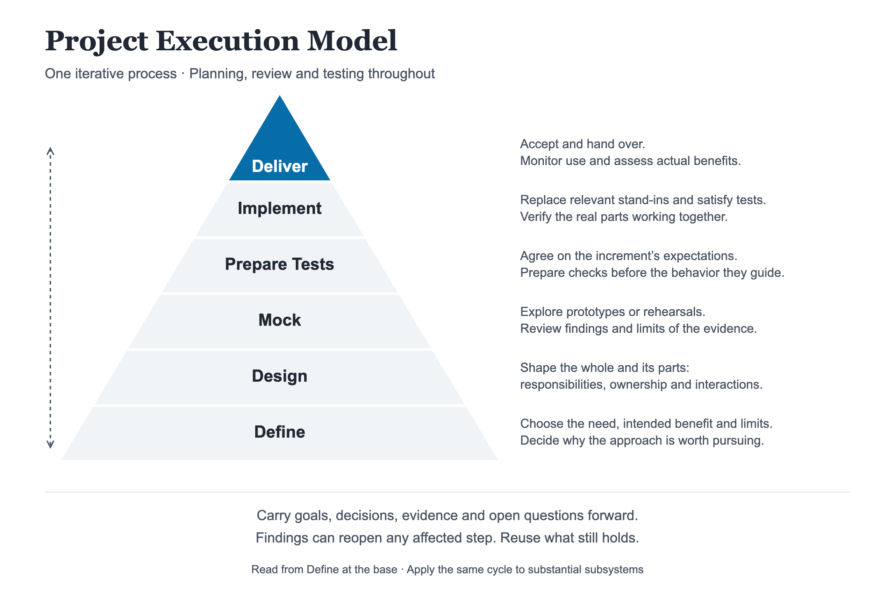
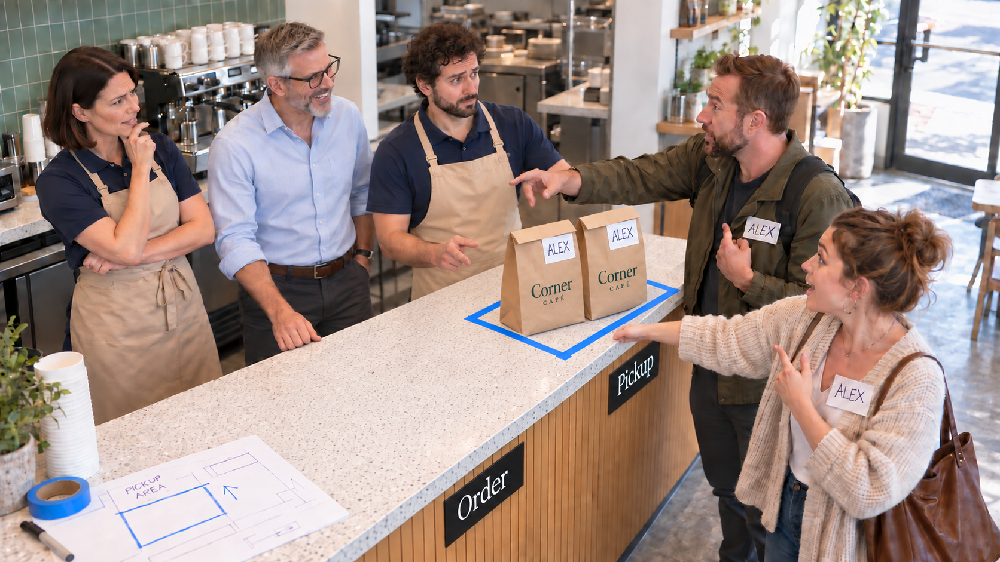

# Project Execution Model

*Version 2.0.0 — Published Deliverables and Project Structure | Released 11 November 2026*

*Initial release: 22 September 2026*

Author: **Leon.id Komarovsky** — [leonid@komarovsky.info](mailto:leonid@komarovsky.info)

## Goal

The Project Execution Model (PEM) helps people turn a need into a working result and learn whether it produces the intended benefit. It connects defining the project, developing and reviewing an approach, preparing checks, making the result real, and delivering it for use and acceptance. Findings from reviews, tests, and actual use guide progress and can change earlier decisions before further commitments.

Human or AI contributors carry the relevant goal, decisions and their reasons, evidence, and open questions between steps. They use this context to build on what still holds, guide the next action, and revisit affected work when findings challenge it. The model is intended for projects across domains, from one-person efforts to large organizations.

## The Project Journey

Six recurring steps connect the choice of what to pursue with a reviewed approach, prepared checks, a real result and evidence from use:

| Step | Guiding Question |
| --- | --- |
| **[Define](#define)** | What should we pursue, and why is it worth the commitment? |
| **[Design](#design)** | How should the whole system and its parts work? |
| **[Mock](#mock)** | What can we learn by trying a representation before making it real? |
| **[Prepare Tests](#prepare-tests)** | What must the next increment demonstrate, and how will we check it? |
| **[Implement](#implement)** | How do we make the agreed result real and satisfy its checks? |
| **[Deliver](#deliver)** | Can people use and accept it, and does it produce the intended benefit? |

> Each step does its own work, reviews and builds on earlier results, and contributes the basis for work that follows.

The order shows how the work builds within **one iterative process**. It does not require each step to finish before another begins: tests can develop with early expectations, and implementation and delivery can overlap. Findings can also send work back: a review can change the design, a test can challenge an assumption, and actual use can reopen the original need. Revisit only affected work and retain what still holds. One contribution may already be in use while another is being designed. At any point, the decision may be to continue, investigate, revise, pause, or stop.

For the next commitment, ask: **what evidence and review are needed, what already applies, and what is the simplest credible way to cover the rest?** Use the [coverage and stopping guidance](#cover-the-system-and-its-parts), [readiness rules](#check-readiness-before-committing) and [guidance on scale](#apply-the-model-at-a-useful-scale) to judge the effort and whether the action is ready. Completing a named step does not replace that judgment.

**A Small Change in Practice**

Maya runs art classes. Boxes of paints and brushes occupy one end of the table, leaving students little room for their work.

**1. Define**

Maya wants to give students more working space while keeping supplies easy to reach. She considers buying a small shelf for the existing supply boxes.

**2. Design**

She measures and weighs the boxes, then checks a low shelf’s listed dimensions and weight limits. She plans to put it beside the door, close to the table.

**3. Mock**

Before buying it, Maya marks the shelf’s footprint on the floor with tape.

She opens the door—and sees that it would hit the shelf. She moves the outline to another wall and walks between it and the chairs. That position leaves both the doorway and the route to the supplies clear.

The outline is enough to choose the position. Whether the real shelf holds the boxes securely still needs checking.

**4. Prepare Tests**

Before buying and setting up the shelf, she lists three checks in her usual class notes, beside the measurements and chosen position:

- All the supply boxes fit.
- The door opens fully, and the route between the chairs and supplies stays clear.
- The loaded shelf is steady and secured as its assembly instructions require.

At the next class, she will also check whether students have enough working space and can get supplies easily.

**5. Implement**

Maya buys the shelf and assembles and secures it in the reviewed position. She puts the existing boxes onto it, then runs the three checks on the real setup. All three pass.

**6. Deliver**

Maya puts the new arrangement into use.

At the next class, students can spread out their work across the table. She watches them collect materials and asks whether the arrangement works for them. They have more room, and the supplies remain easy to reach, so she keeps it.

Maya remains responsible for keeping the shelf usable and the route clear as supplies change.

**Work in checkable increments.** An increment is a manageable piece with a result you can check. Its **[implementation contract](#agree-on-the-implementation-contract)** connects the agreed expectations with the checks: what that piece must deliver and demonstrate. This agreement is in place before implementation, with relevant checks prepared before implementing the behavior they guide. Implementation must satisfy the contract and check how the real parts are built and work together.

Review and testing run throughout the project. Tests are checks against expectations, including manual assessments. They develop across all six steps as expectations emerge. Mocks—stand-ins or rehearsals—help people explore and review proposed behavior.

**Plan and coordinate throughout.** Plans develop alongside the work, including mock creation and reviews. They need revision when findings change the approach.

The choice of the next increment depends on priorities, dependencies and the people, time and resources available when needed. Your project's planning and coordination practices establish these inputs, accounting for existing commitments and [who has authority to decide](#define). Conflicting demands need to be resolved before [confirming readiness](#check-readiness-before-committing) for the increment's commitments. Findings that change the work or its demands go back to the people responsible for those priorities, resources or commitments.

PEM guides the project's work and reasoning while leaving [how work is scheduled and assigned](#boundary) to those practices. You can use PEM without adopting another model or a particular planning tool or document.

The whole project need not be specified upfront, and the steps and practices do not require separate documents.

**Check readiness as commitments grow.** Before a major purchase, live trial, wider rollout or other consequential action, [check readiness](#check-readiness-before-committing) for that action. A milestone can record the decision and its scope; later findings may require it to be revisited.

The fictional café example below follows all six steps, using illustrative images, numbers and operating limits. Use [Main Concepts](#main-concepts) as a working reference for [checks](#develop-tests-throughout), [evidence](#replace-mocks-with-reality-progressively), [commitments](#check-readiness-before-committing) and [scale](#apply-the-model-at-a-useful-scale). Links beside the steps lead to their detailed guidance.

### Define

> *What should we pursue, and why is it worth the commitment?*

Establish the need, who should benefit, the scope of the work and who is responsible. Agree on the completion boundary: what the project must accomplish before it can close. Three separate claims need their own ways of being assessed:

- **Delivery acceptance:** what would make the delivered result acceptable.
- **Outcome success:** what benefit it should produce.
- **Execution constraints:** the time, money, resources, and other limits the project must respect.

Those expectations also give test preparation its starting point. Tests develop alongside them and are refined as the project learns more; a mock review is not a prerequisite for every test.

Choosing an approach means understanding the current situation and baseline, challenging key assumptions and checking major feasibility and resource constraints. Credible alternatives provide a comparison: reuse, purchase, process change, or doing nothing.

The investment rationale explains why the expected benefit warrants the chosen approach's time, money, risk and ongoing obligations compared with those alternatives. Its evidence must be sufficient for the next substantial commitment. Findings that materially change value, cost or feasibility require the rationale to be revisited. A business plan can support this reasoning as a separate, optional project artifact.

These decisions also need clear authority. Identify who can authorize commitments, accept delivery, approve permitted exceptions and close the project, including the limits of that authority.

> **At the café:** At lunchtime, bags of ready food pile up behind the counter. Customers who phoned ahead still wait ten minutes to collect them. Some give up and leave.
>
> Over three lunches, the owner follows collection customers from arrival through handover or leaving without food. Four in ten receive their food within five minutes. These one-off observations give a starting point; staff do not yet keep routine records.
>
> The owner watches the queue. One employee packs orders, but the bags wait for the cashier, who is busy taking new orders. The owner compares hiring another cashier with having the existing packer hand orders directly to collection customers. A separate pickup point could avoid another hire—if the packer can manage both jobs. The owner chooses to explore that option within the existing staffing budget.
>
> The target is that **at least nine in ten customers arriving to collect food receive it within five minutes**. During the first week of regular use, the team will record arrival at the café and handover, or that the customer left without food. Time spent finding the right queue counts too; leaving empty-handed counts as missing the target.
>
> The owner will accept the setup once it passes its checks and staff can take over. That can finish the setup work; the owner will still review the week's results and decide whether the change needs more work.

### Design

> *How should the whole system and its parts work?*

Design connects the experience people need with the arrangement that makes it possible. It describes how the result should work, the requirements it must meet, and the purpose and boundary of the whole system being designed.

> **At the café:** Before moving anything, staff sketch the journey from the entrance. Directions visible from outside split arrivals before they join a queue: **Place an order → Order** on the left; **Already ordered → Pickup** on the right. The cashier takes new orders. The existing packer labels each ready bag with the customer's name and hands it over at pickup.
>
> Walking through the sketch exposes a gap: what happens when a collection customer arrives before the food? They still go to pickup. The packer checks with the kitchen and gives them an accurate update.

The sketch begins to show the system's architecture: the structure that makes the experience possible. Its identifiable parts, or elements, may include people, processes, software, agents, data or hardware. A part can contain smaller parts.

Each part contributes to the result. The design makes its responsibility clear—what it must do or contribute—and establishes its ownership: who builds, brings together, operates or maintains it.

Those parts work together through exchanges of work or information. The means of exchange are their interfaces; what happens through them are their interactions. At the café, the pickup point is an interface between the packer and collection customers. Checking an order and handing over its bag are interactions there.

The early-arrival problem also reveals a dependency on the kitchen. Such dependencies, and how failures are handled, belong in the design. Where relevant, it also makes clear who makes decisions, takes actions and owns information during use.

Guidance helps people and systems take part in the arrangement. The design identifies what intended users and participants need, including operators, maintainers, AI agents or connected systems where relevant. The form and detail of that guidance fit their tasks and conditions: signs or prompts, assistance or training, operating instructions or interface specifications. Users cannot be assumed to read a manual. Reuse suitable guidance; separate documents for each role are not required. Current guidance needs to be findable without reconstructing project history.

The experience and structure develop together, within feasibility and resource limits. The team keeps the whole arrangement in view while working out detail incrementally. The design also includes plans for delivery, adoption, support and recovery if the result fails, where relevant. Substantial subsystems can use the [full execution cycle within their own scope](#apply-the-model-at-a-useful-scale).

### Mock

> *What can we learn by trying a representation before making it real?*

A mock is a stand-in used to explore how something would work. It might be a prototype, sample, or rehearsal. It can also represent an interaction. For example, it can imitate how one software system responds to another, including success, failure, and changes in data or status. A rehearsal can represent a handoff between people.

Mocks give people something concrete to try and question. They help expose misunderstandings and missing behavior before investing in the real result, while design changes are still inexpensive.

> **At the café:** With the journey sketched, colleagues try it together. They approach the café in mixed order, some wanting to order and others to collect. Staff check whether they follow the directions to the right queue, then act out packing and handover with empty bags. Two collection customers are both called Alex.
>
> The wrong Alex gets the wrong bag.
>
> They change the design: each order gets a number, shared by the customer, the order record, and the bag. They repeat the arrivals, collection, and missing-order scenarios. The revised flow works in rehearsal. They replace the old sketch and keep those scenarios for future checks.

Review starts with what needs coverage: the responsibilities, requirements, constraints and interactions of the whole system and each designed part, including smaller parts. Applicable reviews must collectively address these significant aspects under relevant conditions. The [coverage guidance](#cover-the-system-and-its-parts) explains how shared mocks and existing evidence can do that.

Existing review evidence is the starting point for the next commitment. Reuse what still covers the relevant design and conditions. More mock detail is useful when it addresses an uncovered significant aspect or an important unanswered question. Stop adding detail when applicable review evidence covers those needs. Dividing the same design into more named parts does not itself create more review work.

In a new review, appropriate people try the mock manually. For each meaningful mock, the review makes clear what it represents, what people observed under the tested conditions, and what remains unproven. Those open claims carry into later checks; findings that challenge earlier work require it to be revisited. The [review guidance](#review-and-carry-findings-forward) explains preparation, carrying findings forward and organizing the mocks.

Reviewed findings from a [bounded real experiment](#check-readiness-before-committing) supply evidence for a material question when a mock cannot credibly answer it, or when a real trial is justified instead of a disproportionate mock. Mocks are still used for other questions they can usefully answer.

### Prepare Tests

> *What must the next increment demonstrate, and how will we check it?*

Test preparation connects what an increment must deliver with a usable way to assess it. Existing checks are the starting material: reuse or adapt what applies, create or correct checks where needed, and retire obsolete or redundant ones while preserving coverage of still-agreed expectations. The [checks and assessment methods](#validate-assessments) must be validated before their results are relied on.

Before implementation, the increment needs an agreement about what it must deliver, the conditions it must meet and how completion will be assessed. This is the **[implementation contract](#agree-on-the-implementation-contract)**. It covers all agreed expectations assigned to that work; an omitted or inadequate test does not remove an obligation. The agreement must be findable in existing records; no separate contract document is required.

Usable checks are prepared before implementing the behavior they guide. Some are needed to complete the increment; others belong to later delivery or actual use and need assigned responsibility and timing. The current agreement includes any measurement or record-keeping capability these checks will need, even when they run later.

Checks also cover [whether intended participants can use the result](#agree-on-the-implementation-contract).

#### Example: The Pickup Agreement

> **At the café:** Before putting the plan into practice, the owner and staff agree to introduce separate pickup using the existing packer. The setup must demonstrate five results:
>
> 1. Customers find the right queue and receive their own food, matched by order number.
> 2. Every missing order gets a kitchen check and an accurate update to the customer.
> 3. Every order passes the café's usual food-handling checks.
> 4. The packer completes both packing and handover within the agreed staff hours and budget, without making new orders miss the café's quoted preparation times.
> 5. Every collection attempt is recorded accurately, including customers who leave without food.
>
> A numbered bag alone cannot satisfy the first check: they must follow the food through to its recipient. They write the scope on the checklist and keep it beside the reviewed sketch; together these record the increment's contract. They note when each check applies and separate rehearsal results from live results.
>
> Brief packing pauses are allowed, but each resulting backlog of orders waiting to be packed must clear within five minutes of the interruption that started it. Further pickup enquiries do not reset the clock. If that limit is exceeded or a new order misses its quoted time, staff pause the pickup change and call the owner. Recording and the owner's comparison timings count within the same agreed hours and budget.
>
> The owner prepares the recording sheet and tries it from arrival at the entrance through collection or leaving without food. Every attempt is captured. During the live trial, recorded times must also match the owner's comparison timings within ten seconds. All five checks must pass during busy service before the setup is accepted for regular use.

#### Prepare the Next Scenario

Scenario checks can develop one concrete behavior at a time within the increment's agreed expectations. For the next behavior, agree its expected result and prepare its check before implementing it. The scenario list grows as understanding develops; a complete set of checks fixed in advance is not required. The [scenario guidance](#prepare-scenario-checks) and [readiness rules](#check-readiness-before-committing) apply to the work being started.

The café's routing check in [Implement](#implement) shows how to start with one behavior.

### Implement

> *How do we make the agreed result real and satisfy its checks?*

Implementation makes the reviewed design real, replacing some or all mocked parts and interactions and moving rehearsed human work into live practice. The agreed tests provide a concrete target. Satisfying them gives evidence that the real result meets those expectations under the tested conditions; failures guide corrections or reveal a decision that needs revisiting.

**Start with the prepared tests.** Checking what already exists establishes the starting point for the selected scenario. Where possible, run its prepared checks before adding the behavior they guide: identify what already works and confirm failures where required behavior is still missing. For checks that depend on service delivery, see [Live Services](#live-services).

A failure caused by missing implementation is expected at this point and shows work still needed. It remains a [failure, not a pass](#interpret-results), with its cause recorded. Valid passes for behavior that already exists still apply. A check that has not run stays pending, with its assessment method ready. A pass against a mock supports only the behavior and conditions actually tested.

A costly or destructive check need not run merely to confirm known missing work. Prepare its assessment before implementation and agree when it must run. It stays pending until run; any pass required for the next commitment is still required.

**Implement, check, and adjust.** Realization may involve creating, acquiring, arranging, configuring or changing the things required. Reviewed parts and interactions enter real operation incrementally, with their reviewed behavior and interfaces preserved or explicitly revised when findings require it.

**Add internal verification where needed.** Implementation involves choices about individual parts, calculations, connections, failure handling or operational procedures. Internal verification checks those choices. When the need is known, its checks are prepared before the corresponding work; findings can reveal gaps that need new or revised checks. A check can serve both internal verification and the contract. "Internal" does not mean a lower standard or permission to ignore a failure.

Each replacement of a mocked part or increment of real work is checked with the relevant contract and internal checks. Failures guide changes and affected checks are rerun. After the relevant checks pass, the implementation is refined or restructured as needed while preserving agreed behavior and applicable checks. Contributions are combined and evidence collected.

A finding can also expose a missing expectation or flawed approach. That calls for a return to the affected decision and explicit agreement on any contract change. Deviations must remain visible; do not weaken a check merely to obtain a pass.

**Verify the combined result before finishing.** Successful individual parts, mocks or partial replacements do not establish that the whole works. The real parts must be checked working together against the agreed criteria in their intended setting where available. For each piece of evidence, identify the real parts and conditions it applies to.

Where relevant, verification also covers documentation, quality and readiness for delivery, adoption, support and recovery. Applicable guidance must match the real result and be verified through the agreed usage checks. Reuse valid evidence already collected during implementation.

**An implementation increment is complete when its real result, including the relevant combined behavior, meets its agreed expectations and satisfies its required completion checks.** Any permitted exception remains explicit under the [commitment rules](#check-readiness-before-committing). Keep missing evidence visible. Completion does not establish results for checks assigned to later delivery or actual use; carry those obligations forward with responsibility and timing.

> **At the café — Build and Rehearse:** The team puts the sketch and checklist on the counter and starts making the plan real. They first run the checks they can against the current service. The owner's earlier observations have not become an operating routine: staff still do not record arrivals or customers leaving empty-handed, so the recording check fails. Checks requiring the new pickup point remain “not yet tested.”
>
> First, collection customers must find pickup without joining the order queue. Staff clear space within the packer's reach and install the entrance directions, with Order on the left and Pickup on the right. Colleagues approach as customers while others form a queue. One joins the wrong line: people standing in front of the entrance sign hide its arrow. Staff move the sign higher, update the sketch, and repeat the walk-through. Both routes now work in this check.
>
> Next, every collection attempt must leave an accurate record. They put the prepared sheet and clock where counter staff can see arrivals and handovers, then practise recording them. One colleague leaves without collecting anything; that must appear on the sheet too. They compare the entries and timings with the owner's record. The check passes in rehearsal; keeping the records accurate during lunch still needs testing.
>
> **Try a Few Real Orders.** For correct handovers, they introduce matching numbers on order slips and bags and practise giving each customer their number. The packer uses it to match the food to its recipient and checks with the kitchen when an order is missing. Once food-handling checks pass and staff can carry out the handoffs and recording routine, the owner authorizes a few real orders. A full lunchtime trial will follow only when the small trial's required checks pass.
>
> Then part of an order number folds underneath a bag. The packer misreads it and hands the bag to the wrong customer.
>
> The failed handover leads to another check: **do numbers stay readable when bags are stacked and carried?** The current labels fail. Staff move them higher on the bags and update the sketch. They add the visibility check beside the handover check, then repeat both and any other affected checks. This time, both pass in the small trial. The missing-order rehearsal result still applies: moving the labels changes neither the kitchen check nor the customer update.
>
> **Check the Full Lunch Service.** Once the small trial passes, they run a full lunchtime trial, checking customer routing and how the kitchen, packing, and pickup work together. All five checks pass during that lunch. Of 20 collection arrivals, 18 receive food within five minutes; two take longer and none leave without food.
>
> Staff also observe two brief pauses in packing during longer pickup enquiries. New orders wait, but each backlog clears within five minutes of the interruption that started it and the orders stay within their quoted preparation times. Staff recording and the owner's comparison timings fit within the agreed hours and budget, without extra staff hours. One lunch does not establish the first week's benefit.

### Deliver

> *Can people use and accept it, and does it produce the intended benefit?*

**Accept delivery.** Delivery makes the result available for use through handover or activation, with support for adoption and intended use. Checks requiring the real setting or actual use run at their agreed times, including during delivery. The agreed test requirements apply to delivery, acceptance and closure; new conditions or gaps call for added or refined checks. Evidence and unproven claims must be stated separately for delivery acceptance, outcome success and execution constraints.

**Follow through on the benefit.** Some benefits can be assessed only through actual use. They need an owner and a time or condition for the check. That owner compares the evidence with the intended benefit and makes or obtains an authorized decision to continue, improve, reconsider the approach or stop. Acceptance alone does not prove that the benefit occurred.

**Hand over and close.** Closure distinguishes completed project work from responsibilities that continue in use. Confirm acceptance and handover, settle required obligations, assign ongoing responsibilities, clean up temporary resources and record lessons. Current guidance travels with the result, with responsibility for keeping it up to date and superseded instructions clearly distinguished. Relevant closure responsibilities also apply when a project stops early, even if nothing is delivered. The [café handover note](#example-a-handover-note) shows how these decisions can be kept together.

Pending checks connect closure to later decisions. For every permitted pending check, it must be clear when it will run, who will act on its findings and what decision it will inform. If it depends on conditions that may not occur, it needs a review date. The agreed completion boundary governs closure, with later testing and outcome-review responsibilities explicitly accepted by the receiving owner. Pending checks and exceptions remain distinct from passes after acceptance and closure.

*The dashboard illustrates the story. The outcome measure counts every collection attempt, including departures without food; the timing bars alone do not show that complete record.*

> **At the café:** The owner accepts regular use of the current setup. The required checks passed, waiting times look promising, and the arrangement is inexpensive to reverse. The packing pauses need watching even though the queue cleared in the trial. Staff take over using the updated sketch and checklist, including the backlog and new-order limits; customers use the entrance directions. The owner keeps the staff reference and customer directions current when the process changes. If packing cannot keep up or a required operating check fails, they pause the affected work and call the owner.
>
> With handover complete, the setup work can close. The owner remains responsible for reviewing the first week's waiting times and packing observations and acting on the results. Until then, the weekly benefit remains unproven.
>
> At the end of that week, the result is **seven in ten**.
>
> The target was nine.
>
> The observed rate is higher than the four-in-ten baseline. The comparison alone does not establish how much improvement the pickup change caused; demand and order mix may differ.
>
> The setup passed its delivery checks, but too many customers still wait too long or leave without food. The change has not achieved the benefit that justified it.
>
> The owner approves further improvement. The team returns to Design with the collection records to find the remaining delay, keeping the checks and evidence that still apply. What they learn may change the pickup process—or make them reconsider whether it addresses the main cause of the waiting.

#### After the Project Closes

While the result remains in use, the receiving owner is responsible for relevant testing and monitoring of how it works and whether it delivers the intended benefit. At handover, the checks, responsibility and timing or triggers are agreed in proportion to risk and change. Findings guide maintenance, improvement or reconsideration of the original need or approach. Routine work follows established procedures; substantial improvements use this model at a useful scale, carrying forward applicable goals, decisions, evidence and open questions.

#### Live Services

**Implementation and delivery can overlap for a live service.** For a course, the offer and booking arrangements are checked before taking bookings, teaching and venue arrangements during the sessions, and learning outcomes afterward. Each commitment has agreed checks needed before it; the remaining evidence is collected at its assigned time.

**A project to launch or change a service has its own completion boundary.** It may include a pilot or first group of customers. Routine delivery uses established procedures and checks for each customer, without a fresh project cycle for every engagement. New findings can reopen the service's design or the original decision to offer it.

## Main Concepts

This reference supports decisions and work throughout the journey, whether the project changes software, a service, a physical product or a way of working.

The summaries explain the concepts; the expandable Working Guidance contains the applicable rules and conditions. The index points to guidance for common decisions. Examples use particular layouts and records to illustrate the rules; those formats are not requirements for every project.

| When You Need To… | Guidance |
| --- | --- |
| Choose what to pursue and who can decide | [Define](#define) |
| Design how the system and its parts work | [Design](#design) |
| Choose how much preparation is enough | [Coverage and stopping conditions](#cover-the-system-and-its-parts) and [scale and reuse](#apply-the-model-at-a-useful-scale) |
| Continue work, hand it over or close the project | [Advance With Evidence](#advance-with-evidence), [connected use and maintenance](#use-and-maintain-mocks-and-checks), [acceptance, handover and closure](#deliver), and the [handover note](#example-a-handover-note) |
| Coordinate contributions and changes across teams | [Affected decisions](#decisions-and-commitments), [coordinated updates](#use-and-maintain-mocks-and-checks), and [contributions within a larger project](#apply-the-model-at-a-useful-scale) |
| Monitor use and assess benefits | [Delivery and outcome review](#deliver) and [After the Project Closes](#after-the-project-closes) |
| Review a design through mocks | [Coverage and stopping conditions](#cover-the-system-and-its-parts) and [review findings](#review-and-carry-findings-forward) |
| Agree and prepare checks | [Test development](#develop-tests-throughout), the [implementation contract](#agree-on-the-implementation-contract), [scenarios](#prepare-scenario-checks), and [assessment validation](#validate-assessments) |
| Understand an unexpected result | [Investigate findings](#use-and-maintain-mocks-and-checks) and [interpret results](#interpret-results) |
| Make a consequential commitment | [Readiness, required checks and exceptions](#check-readiness-before-committing) and [live-service timing](#live-services) |
| Replace stand-ins and interpret their evidence | [Progressive replacement and evidence limits](#replace-mocks-with-reality-progressively) and [mock/test relationships](#connect-mocks-and-tests) |
| Work within a larger project or system | [Apply the Model at a Useful Scale](#apply-the-model-at-a-useful-scale) |

The guidance relies on a current view of the project's scope, assumptions, decisions and evidence. Manage the project's dependencies, resources, budget, risks and communication throughout the work. Address relevant safety, privacy, security, accessibility and other obligations.

### Advance With Evidence

A project can move forward by discovering that something needs to change. An early rehearsal might expose a problem that would be expensive to discover after launch. The useful result is a better-informed decision about what comes next.

That learning can affect more than the work in front of us. An earlier choice may need reconsidering, while other parts remain sound. The project carries those sound parts forward and revisits the decisions and checks affected by the finding.

The reasoning also needs to survive a handoff. Someone joining later should be able to understand what was decided, why, what the evidence supports and what remains uncertain. Otherwise, they inherit the result without the understanding needed to continue it.

Working Guidance: Investigating Findings, Decisions, Records and Evidence

#### Decisions and Commitments

Continue from what still holds when a review supports the approach and readiness checks are satisfied. Finding an important problem before a larger commitment is progress because changing course still costs less.

Before choosing a change, [investigate the finding](#use-and-maintain-mocks-and-checks). Check whether it challenges an earlier decision and which dependent work and evidence may be affected, including beyond the current contribution. Revisit affected decisions, keep what still applies and repeat necessary checks.

The [readiness rules](#check-readiness-before-committing) determine what can continue and what must be resolved before the next commitment. Actual use can reopen the original need or approach even after accepted delivery.

Fixing a test or adding coverage is different from changing the intended target. Changes to expectations or the implementation contract need agreement with the responsible decision-maker. Keep the reasons and supporting evidence visible; do not quietly redefine failure as success.

#### Records and Handoffs

Carry the goal, decisions and their reasons, evidence and open questions between steps and contributors. Records need enough context to continue or assess the work, investigate it, hand it over and operate the result without reconstructing earlier discussions.

Choose the detail to suit the record's intended use. Reuse records that already do the job, adding only missing context or references. Keep useful exploration and abandoned approaches when their reasons or findings would otherwise be lost.

Routine events may still need systematic recording for checks or operation. At the café, a brief project note does not replace the record of every collection attempt.

#### Evidence, Corrections and Gaps

Separate observations from explanations, and attempts from demonstrated results. Include enough context to interpret them.

Make it clear what is current. Important corrections and their reasons must remain understandable; a brief note or an existing version reference can be enough.

If a known gap in the record limits a conclusion, make that clear. Missing records do not prove that nothing happened. Writing down a claim does not fill a gap in the evidence.

### Develop Tests Throughout

Expectations become clearer as a project develops. Defining the need raises questions about the benefit. A mock can expose a missing behavior, and actual use can reveal a condition nobody had considered. The tests grow with that understanding.

For the next piece of work, contributors need a shared answer to “What would show that this is done?” The implementation contract connects its agreed expectations with the checks that will assess them. Preparing the relevant checks before implementing the behavior gives the work a concrete target.

A check also needs to earn our confidence. It should recognize a plausible wrong result as well as an acceptable one. And its result needs careful interpretation: a failure in the work, an unfinished check and a problem with the assessment method do not tell us the same thing.

Working Guidance: Test Preparation, Implementation Contract, Scenarios, Assessment and Results

#### Prepare Usable Checks

Preparing a test means having a usable way to assess a result. Naming what to check is not enough. Each check needs its conditions, expected result, evidence, timing and responsibility. Criteria are measurable where meaningful; otherwise, they must be observable and have an explicit assessment method.

As expectations emerge across all six steps, checks develop with them. **[Relevant checks are prepared](#prepare-scenario-checks) before the work they will guide.** Exploration can have its own questions and checks, and each check runs when the necessary evidence is available. Checks assigned to an implementation increment must be agreed as part of its [implementation contract](#agree-on-the-implementation-contract).

Coverage must include all agreed expectations about behavior, quality, delivery acceptance, intended benefits (such as profit where relevant) and execution constraints. It also includes important assumptions, failure cases and unintended effects.

Contributors need to understand what each test checks, how the tests fit together, and [how to run them and interpret their results](#use-and-maintain-mocks-and-checks). The organization of the tests must show which checks apply to which conditions and commitments. Also check whether the tests would detect relevant wrong results. When a decision changes, affected tests are updated without losing coverage of expectations that still apply.

Assessment can be manual or automated. Before anyone relies on a method, its tools, access and measurement capability must be checked as usable. For a check scheduled later, the prerequisites need to be identified and ready before it runs. Preparing a check does not make it a pass.

#### Agree on the Implementation Contract

**The implementation contract is the agreement on what an increment must deliver, the conditions it must meet, and how completion will be assessed.** Relevant tests are prepared before implementing the behavior they guide; their results assess those expectations.

All agreed expectations assigned to the increment belong in that agreement: what it must do, how people or parts exchange work or information, the required quality and limits, and how those people or parts work together. Those responsibilities determine the tests, not what is easiest to pass.

The agreement also includes checks of whether intended participants can use the result. Representative tasks, relevant exceptions and handoffs test use with the guidance, support and prerequisites they will actually have. Where use without a briefing is expected, it must be checked that way.

The agreement brings together the applicable scope and constraints, inherited requirements, agreed design, and decisions from mock reviews or real experiments. It must be findable from the increment's existing record. That record can state the expectations or reference the specific current design, reviewed mocks and tests that apply. No separate contract document or test framework is required. The [café's sketch and checklist](#example-the-pickup-agreement) show one way to record this agreement.

The checks follow the same parts and levels as the mocks. They must cover each part's agreed responsibilities, requirements, constraints, interfaces and interactions, including how parts work together within their larger parts and across the whole system. A shared check can cover several parts while assessing each part's agreed expectations. The choice of manual or automated checks, including assessments of an AI agent's behavior where relevant, depends on what each can credibly establish.

Mock review informs and refines the tests. The design and its reasons remain alongside the checks. The coverage question is: **could all these checks pass while an important part of the intended result is missing or wrong?** Any gap in assessment must be identified and addressed against the agreed need and success criteria. An omitted or inadequate test does not remove an agreed expectation.

For the [checks prepared before implementation](#develop-tests-throughout), the agreement states the conditions, what a pass looks like, the evidence needed and which commitments depend on the result. It identifies checks that need real people or parts working together.

Checks needed to complete this increment remain distinct from those assigned to later delivery or actual use. The later checks need responsibility and timing. If they need measurements or records, the ability to collect them belongs in the implementation contract now.

[Connect Mocks and Tests](#connect-mocks-and-tests) explains how reviews, substitutes and real parts can inform different checks.

#### Prepare Scenario Checks

A scenario gives a check a concrete situation: **given these conditions, when this action or event occurs, then this observable result is expected**. Scenarios help participants agree relevant rules, assumptions and open questions. Expected results come from the agreed expectations, independently of what the implementation happens to produce.

Observable results are preferred. An interaction also needs checking when it is itself required: for a missing order, the café requires a kitchen check as well as an accurate customer update.

The increment's scenarios form a working list. The next behavior is selected and a usable check is prepared for it before implementation. As understanding grows, the list and affected checks are extended. The whole set of checks need not be complete or fixed before implementation begins. The [readiness rules](#check-readiness-before-committing) still apply to each commitment.

#### Validate Assessments

A check and its assessment method need to distinguish an acceptable result from a wrong one. Validation tests that ability with representative examples that should pass and plausible examples that should fail. The set of checks is also reviewed for important omissions. Assessment failures and insufficient evidence remain explicit.

Deciding how each example should be assessed comes first. That decision uses the agreed expectations, relevant outcome evidence and appropriate review, and must be independent of the method being checked.

For the café's timing comparison, a recorded time within the agreed ten seconds of the owner's time should pass. One outside that tolerance should fail.

Correct results can vary. For an accuracy check, suppose the kitchen confirms that an order is being prepared. “The kitchen is preparing your order” and “Your order is being prepared” can both pass; “Your order is ready” should fail.

Mistaken acceptance or rejection needs investigation. Where judgment matters, consistency needs checking too. Introducing a known defect, or comparing a check's decisions with examples independently reviewed by appropriate people, can help. Validation effort is scaled to the importance of the expectation and the decisions that depend on it.

#### Interpret Results

The three outcomes are:

- **Passed:** valid, applicable evidence shows that the agreed criteria were met under the recorded conditions.
- **Failed:** the check ran and its criteria were not met. This includes a check that fails as expected because the real component has not yet been built; record why it failed.
- **Pending:** no valid outcome is available yet: the check has not run or completed, or the assessment could not determine whether its criteria were met. This differs from a valid failed result; neither status is a pass.

An assessment sometimes cannot establish whether a criterion was met. The check then stays **pending**, with the reason explained. A problem with the person, tool, process or supporting systems used for assessment is recorded separately from the work being assessed. An unsuccessful assessment attempt supplies neither a valid pass nor proof that the work violates the criterion. Inability to access evidence differs from reliable evidence that a required result is absent; insufficient evidence must remain explicit.

For example, an observed collection attempt missing from the completed record fails the recording check. If the record is inaccessible and the assessment cannot determine whether the attempt was recorded, the check remains pending.

A pass for one case does not establish how reliably the result will work across future cases. Further observations can reduce uncertainty or reveal variation, including when the stated conditions are unchanged. Their value depends on what they could change about the next decision. Later passes do not erase earlier failures or their follow-up decisions.

Every known failure needs a recorded decision and any follow-up, even when it does not block the next commitment. For an expected failure caused by work not yet implemented, the existing agreement to complete that work can serve as the record. A failure that challenges the agreement needs a further decision. Approved exceptions are recorded separately. The same evidence limits apply to contract tests, internal verification and later project checks.

### Check Readiness Before Committing

“Ready” means ready for a particular next step. At the café, trying a few real orders, using the setup every day and rebuilding the counter involve different commitments. Evidence that supports one may be too weak for another.

The project can move without knowing how everything will turn out. For the commitment being considered, it needs enough evidence, the necessary preparation and the authority to act.

Sometimes a real experiment is the next useful way to learn. It is a commitment too, with its own question, checks and limits. What it shows—and what remains uncertain—then shapes the design and the next decision.

The working guidance below sets the conditions for proceeding.

Working Guidance: Readiness, Required Checks, Exceptions and Real Experiments

#### Readiness for the Next Commitment

Before **any costly or consequential commitment**, check that the evidence is sufficient and the approach, dependencies, resources, authorization and other prerequisites are ready. You need enough evidence for that commitment, not certainty about the whole project. Work that depends on material decisions still being explored must not be implemented.

An implementation increment can start when its relevant decisions are sufficiently reviewed, checks are prepared for the work being started, and its other prerequisites are ready. Each commitment needs an agreement about which checks must pass and which may remain pending. The checks required to begin a limited live trial are distinct from the evidence that trial will produce for later rollout or acceptance. A behavior test may fail before implementation and still be required to pass before delivery.

#### Required Checks and Exceptions

**A required test without a valid, applicable pass blocks the commitment it governs**, unless an authorized decision-maker explicitly approves a permitted exception. An exception is permitted only within the project's agreed limits, applicable obligations and the decision-maker's authority.

Approval of an exception permits a specified action; it does not change a test result or supply missing evidence. The exception's record must include its justification, the specific commitment permitted, remaining risk and any conditions or follow-up.

#### Bounded Real Experiments

When a mock cannot credibly answer a material question, use a bounded real experiment.

Even when a mock can answer the question credibly, preparing or reviewing it can take disproportionate effort for the evidence it could add. In that case, compare suitable mock options, including simpler or reused work, with the proposed trial. The comparison covers expected evidence, effort, delay, consequences and remaining uncertainty. Use the trial only when that comparison justifies it. Record the reasons in the existing project record; cost alone is not sufficient.

The experiment itself needs a clear question, a prepared assessment method, limits, required authorization and stopping conditions. Its risks and commitments must fit the project's limits, obligations and decision-maker's authority. If neither a suitable mock nor an acceptable trial is available, retain the uncertainty and reconsider the next commitment.

The trial's findings are reviewed for what was established under its conditions and what remains uncertain. Both feed into design, test preparation and the next commitment decision. Other significant review obligations still apply.

#### At the Café — Judge the Next Commitment

Using the [full-lunch trial evidence](#implement), the owner compares three possible next commitments.

##### Another Limited Trial

The owner would run another limited trial if a different order mix could expose a sustained packing delay that would change operating limits, and answering that question would be worth the cost or delay. A similar lunch could also be worth observing if it would reduce uncertainty enough to change that decision. Repetition just to raise a pass count adds little; the question is what another observation could establish.

##### Regular Use of the Current Setup

The owner accepts the inexpensive, reversible arrangement with monitoring: required checks passed and the packing queue cleared. The first week's records are already needed to assess waiting times and packing. Gathering them during regular use can inform whether to continue, improve or stop; another trial just to accumulate passes adds little. The weekly benefit remains unproven.

##### An Expensive Permanent Counter Refit

The owner defers this hard-to-reverse investment. One lunch does not establish sustained benefit or justify the refit against cheaper options. The owner would reconsider if evidence showed that the refit offered enough advantage over the current or a cheaper arrangement to justify its extra cost. They would gather that evidence if its likely value for the refit decision were worth the effort. The refit's design, budget and authorization must also be ready.

If an equally suitable, cheaper arrangement already meets those needs, the owner can stop pursuing the refit; more successful pickup trials would not justify its extra cost.

### Replace Mocks With Reality Progressively

A rehearsal can show that the café’s pickup directions make sense. It cannot show whether the kitchen will keep up at lunchtime. A mock lets people explore a proposal before putting the whole result into use, but its evidence stops at what they actually tried.

Implementation turns the reviewed proposal into real parts and live work. The project checks each change and how the real parts now work together. Questions that the mock could not settle stay open until later checks provide evidence.

Some stand-ins remain useful after implementation. A simulated service can reproduce a slow reply so a real part’s response is easier to check. That test says something about the part being tested; it does not establish that the real service works.

Working Guidance: Mock Coverage, Reviews, Tests and Maintenance

Each useful increment builds on [reviewed mocks or still-applicable review evidence](#mock). Reviewed findings from a [bounded real experiment](#check-readiness-before-committing) can serve that purpose only when the route is justified by the readiness guidance.

As stand-ins become real parts and rehearsals become live practice, [each change and the relevant real combined result need verification](#implement). Unresolved claims carry into later checks.

#### Cover the System and Its Parts

Mock coverage follows the system defined in [Design](#design). It must let people review how each element fulfils its responsibilities, meets its requirements and constraints, and interacts with other elements. These are the **significant aspects** of its design.

The coverage includes the whole system and every part, down to smaller parts at every level. Each part’s own purpose and responsibilities need consideration as its design develops. Being small does not remove it from consideration.

Simple mocks or rehearsals prioritize coverage over polish. Start with the current design and applicable review evidence. One mock or still-applicable evidence can cover several parts when the review addresses each part’s significant aspects and interactions under relevant conditions. This coverage can be reused; a separate mock, repeated review or [full execution cycle](#apply-the-model-at-a-useful-scale) is not required merely because the design has several parts.

Coverage also gives mock preparation a stopping point. For the [next commitment](#check-readiness-before-committing), identify any significant aspect still unreviewed or material question left unanswered. Further detail or review addresses those remaining needs. Stop adding detail when applicable review covers them. Design changes, changed conditions or new findings reopen the affected coverage; retain what still applies. Exploration follows risk, uncertainty and what further evidence could change. Naming more parts alone does not require more mocks or reviews, but an uncovered responsibility or interaction still needs attention.

At the café, one rehearsal can review directions, order numbers and handover together. A rehearsal of successful collections alone would leave the kitchen check and customer update for a missing order unreviewed. Rehearsal does not establish how the real lunch service performs.

#### Review and Carry Findings Forward

People need to know what a review is meant to explore. That means clear questions, conditions and participants, with draft usage guidance where it helps. The mock itself must be checked: does it represent the agreed design well enough for meaningful review of its significant aspects under those conditions?

When a new review is needed, appropriate people try the mock manually. Intended users, affected parties or relevant expertise are involved where needed. They look for problems with usefulness, clarity, feasibility and missing behavior. When findings call for change, refine the mock or revisit the affected decisions.

Each meaningful mock needs a brief account of **what it represents, what people observed under the tested conditions, and what remains unproven**. Those open claims carry into later checks. For example, a user interface connected to a simulated service can show how it handles a reply that does not arrive in time; it cannot show that the real service recovers correctly.

Reviewed findings from a justified [bounded real experiment](#check-readiness-before-committing) serve the questions it addresses. Keep mocks for other questions they can usefully answer.

Review develops the design and its tests together. Preparing a check can expose a problem with the mock or design; the affected work must be revised before anyone relies on it. The reviewed proposal, reasons for its choices, evidence and remaining uncertainty carry forward together. Each element must remain identifiable through its design, mocks, checks, implementation and later evidence.

A contributor also needs to understand what each mock represents, how the mocks fit together and [how to use them](#use-and-maintain-mocks-and-checks) to explore the proposed result. Their organization identifies current versions and alternatives. Decisions that change the work require affected mocks to be updated or retired.

#### Connect Mocks and Tests

A mock may help people decide what to check or create controlled conditions for a check. Its own behavior may also need checking. These uses establish different things. Prototypes and rehearsals count too; the appropriate assessment method may change as the work becomes real.

| Relationship | What It Can Establish |
| --- | --- |
| Review a mock to create or refine checks | Explore expectations and cases to check against the agreed requirements and reviewed design. |
| Check a real part using stand-ins for the parts it relies on | Assess its behavior under controlled conditions. This leaves the real supporting parts, and how all the real parts work together, unverified. |
| Test a mock itself | Check whether the mock is suitable for exploration or behaves as intended. A reusable substitute can also be checked for how faithfully it represents the relevant design. The result applies to the mock. |
| Apply suitable shared checks to a substitute and its real replacement | Check relevant interface and behavior expectations and spot differences as the design or implementation changes. Wider behavior and the real parts working together still need their own evidence. |

These relationships need no one-to-one mapping. A manual prototype review can inform a later automated check. Stand-ins for supporting parts may remain useful for [controlled conditions](#connect-mocks-and-tests) after implementation, such as replies that do not arrive in time. Their passes support only what was actually tested; they do not prove that the real part represented by the stand-in works or that the real parts work together. Checks of the real parts and combined result are still needed.

#### Use and Maintain Mocks and Checks

The starting point is the expectation or change and the part it concerns. From there, contributors need to find the relevant current design, mocks, checks and evidence, connected and easy to use. That includes checks for affected smaller parts, the larger parts they belong to, how those parts work together and the checks required for the next commitment. The [café handover note](#example-a-handover-note) shows one way to connect this material.

Finding the right material is only part of using it. Instructions and prerequisites also need to be easy to find. Before exploring a mock or running a check, confirm that the needed people, tools, access and records are ready. Follow the applicable instructions. The result and its supporting evidence must stay accessible: what was assessed, relevant conditions or versions, what was simulated and what remains unproven.

A finding does not by itself locate the problem, so investigation comes before choosing what to change. The cause may be in the implementation, mock, check or assessment method, supporting setup, or unresolved expectations. Involve the relevant owner or decision-maker. If the cause remains uncertain, record that uncertainty and the next investigation. The [result rules](#interpret-results) and [commitment rules](#check-readiness-before-committing) govern what can proceed.

Changing one part can affect several connected materials. Updates to the affected design, mocks, checks and instructions need coordination with their owners. [Checks for new scenarios](#prepare-scenario-checks) must be prepared before implementing the behavior they guide. Relevant [assessment validation](#validate-assessments) needs to be revisited when its basis changes. Current, superseded and historical work must remain distinguishable.

Suitable mocks, checks, methods and evidence are reused. Preparation and rechecks follow the affected responsibilities and the next commitment, proportionate to risk and uncertainty.

Contributors need to be able to use the connected materials together, and that needs checking through a representative workflow. They find and select relevant work, establish prerequisites, explore or run a case, interpret the result, and update or extend the affected work using retained context. The workflow must exercise the relevant design, mocks, checks, instructions and evidence together. Reuse suitable evidence and keep the effort proportionate to risk and uncertainty.

##### Example: A Handover Note

For the [owner's decision after the full-lunch trial](#check-readiness-before-committing), an existing shared note could read:

> **Pickup handover — café owner to staff**
>
> I approve regular use of the current setup within existing staff hours and budget. Use the updated sketch and [checklist](#example-the-pickup-agreement) for the [reviewed flow](#mock); the permanent counter refit remains deferred.
>
> **Passed:** the five agreed checks in the [full-lunch trial](#implement). Packing briefly paused, but the queue cleared without extra staff hours. This supports monitored use of the inexpensive, reversible setup.
>
> **Pending:** the [first-week benefit check](#define). Record every collection attempt from café arrival to handover or leaving without food, and watch packing against our five-minute backlog limit and quoted new-order times. If packing cannot keep up or a [required operating check](#check-readiness-before-committing) fails, pause the affected work and call me.
>
> At the end of the first week of regular use, I’ll compare the waiting times with our target, review packing and decide whether to continue, improve, reconsider or stop. Setup work can close after handover; I retain this review.

The note keeps permission, reasons, scoped results and follow-up together, with links to supporting context. It can live in an existing working record; this layout is illustrative.

### Apply the Model at a Useful Scale

Some parts of a project need decisions of their own about what to make, how it should work and how to check it. The same model can guide that smaller piece of work while keeping it connected to the larger project.

Substantial contributions—including subsystems and work within implementation—use the same six recurring steps within their own scope when they have meaningful uncertainty or consequential commitments. A subsystem can itself contain substantial contributions that use the same approach. A minor, well-understood task needs no nested cycle.

This local work inherits the parent project's or system's relevant goals, requirements, constraints, decisions, interfaces and evidence. These guide its scope and responsibilities and the agreement on its checks.

A finding that challenges an inherited decision goes back to the parent project or system for review. The contribution returns its real result, checks and evidence. The parent still integrates and verifies the combined outcome.

The level of coordination and checking follows risk, uncertainty and complexity. Combine activities and records while covering relevant responsibilities. Reuse applicable evidence and existing records; a separate document, team or ceremony is not required for each step.

## Boundary

This model is self-contained guidance for project execution: it can be understood and used without adopting another model. It works with the project's existing arrangements for planning, coordination and decision authority. General definitions and rules for work, roles, work-item structures, and the mechanics of operational planning belong to the separate Work Management Model.
