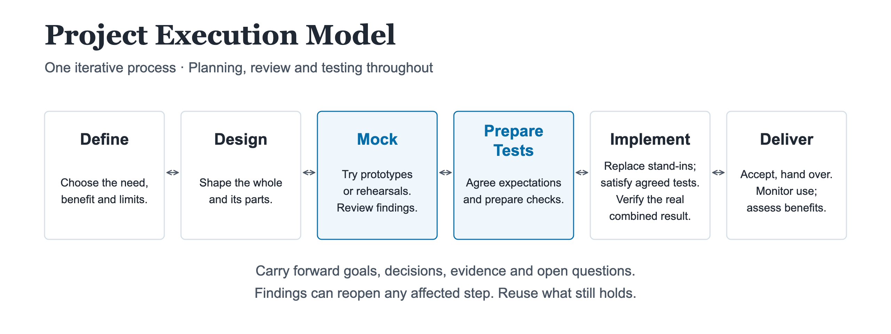

# Project Execution Model

*Version 1.2.0 — Six Steps, One Process | Released 28 October 2026*

*Initial release: 22 September 2026*

Author: **Leon.id Komarovsky** — [leonid@komarovsky.info](mailto:leonid@komarovsky.info)

## Goal

A project can deliver exactly what was agreed and still fail to solve the problem that started it. As plans, discussions, and results accumulate, the reason for a decision can become hard to find. When work changes hands, the next contributor may receive the result without knowing what has been checked or what remains uncertain.

The Project Execution Model guides a project from an initial idea through delivery, acceptance, and learning from real use. Throughout the project, carry forward the relevant goal, decisions, evidence, and open questions so the next human or AI contributor can build on what is known and challenge what no longer holds. It applies across domains, from one-person projects to large organizations.

## The Project Journey

Six recurring steps give the project direction:

| Step | Guiding Question |
| --- | --- |
| **[Define](#define)** | What should we pursue, and why is it worth the commitment? |
| **[Design](#design)** | How should the whole system and its parts work? |
| **[Mock](#mock)** | What can we learn by trying a representation before making it real? |
| **[Prepare Tests](#prepare-tests)** | What must the next increment demonstrate, and how will we check it? |
| **[Implement](#implement)** | How do we make the agreed result real and satisfy its checks? |
| **[Deliver](#deliver)** | Can people use and accept it, and does it produce the intended benefit? |

> Each step performs its own work, reviewing and building on earlier results, and produces the basis for the next step.

These steps form **one iterative process**. Work moves between them as findings require: a review can change the design, a test can challenge an assumption, and actual use can reopen the original need. Revisit only affected work and retain what still holds. One contribution may already be in use while another is being designed. At any point, the decision may be to continue, investigate, revise, pause, or stop.

Use the journey to see the model in practice. Return to [Main Concepts](#main-concepts) for detailed guidance on [tests](#develop-tests-throughout), evidence, [commitments](#check-readiness-before-committing), and [scale](#apply-the-model-at-a-useful-scale).

**Review and testing run throughout.** Tests are checks against expectations, including manual assessments. They develop across all six steps as expectations emerge. Mocks—stand-ins or rehearsals—help people explore and review proposed behavior.

Work in **increments**: manageable pieces with a result you can check. Before implementing each increment, agree on its expectations and checks. Together, these form the **implementation contract**, the shared agreement about what that piece must deliver and demonstrate. Prepare relevant checks before implementing the behavior they guide. During implementation, satisfy the contract and check how the real parts are built and work together.

Progress brings greater commitments. Before a major purchase, live trial, wider rollout, or other consequential action, [check readiness](#check-readiness-before-committing) for that particular commitment. A milestone can record that decision and its scope; later findings may require it to be revisited.

**Plan throughout the project**, including mock creation and reviews, and revise plans when findings change the approach.

The whole project need not be specified upfront, and the steps and practices do not require separate documents.

The example running through these steps follows a café. At lunchtime, bags of ready food pile up behind the counter. Customers who phoned ahead still wait ten minutes to collect them. Some give up and leave.

### Define

> *What should we pursue, and why is it worth the commitment?*

Establish the need, who should benefit, the scope, and who is responsible. Agree on the completion boundary: what the project must accomplish before it can close. Keep three claims separate, with a way to assess each:

- **Delivery acceptance:** what would make the delivered result acceptable.
- **Outcome success:** what benefit it should produce.
- **Execution constraints:** the time, money, resources, and other limits the project must respect.

Start preparing tests alongside these expectations. Refine them as the project learns more; a mock review is not a prerequisite for every test.

Investigate the current situation and baseline, challenge key assumptions, and check major feasibility and resource constraints. Compare credible approaches, including reuse, purchase, process change, or doing nothing.

Explain why the expected benefit warrants the chosen approach's time, money, risk, and ongoing obligations compared with those alternatives. Use enough evidence to justify the next substantial commitment, and revisit the rationale if findings materially change value, cost, or feasibility. A business plan can support this reasoning as a separate, optional project artifact.

Identify who can authorize commitments, accept delivery, approve permitted exceptions, and close the project, including the limits of that authority.

> **At the café:** The owner watches the queue. One employee packs orders, but the bags wait for the cashier, who is busy taking new orders. The owner compares hiring another cashier with having the existing packer hand orders directly to collection customers. A separate pickup point could avoid another hire—if the packer can manage both jobs. The owner chooses to explore that option within the existing staffing budget.
>
> The target is that **at least nine in ten customers arriving to collect food receive it within five minutes**. During the first week of regular use, the team will record arrival at the café and handover, or that the customer left without food. Time spent finding the right queue counts too; leaving empty-handed counts as missing the target.
>
> The owner will accept the setup once it passes its checks and staff can take over. That can finish the setup work; the owner will still review the week's results and decide whether the change needs more work.

### Design

> *How should the whole system and its parts work?*

Describe the requirements and intended experience alongside the **architecture**, the structure that makes them possible. Identify the **system** being designed: its purpose and boundary.

Break the system into **elements**—identifiable parts such as software, agents, data, people, processes or hardware. An element can contain smaller parts, called child elements. This breakdown into parts and smaller parts is its **decomposition**.

For each part, make clear what it must do or contribute: its **responsibility**. Identify who builds, brings together, operates or maintains it: its **ownership**.

Describe its **interfaces**, the means through which it exchanges information or work, and its **interactions**, what happens through those interfaces. At the café, the pickup point is an interface between the packer and collection customers; checking an order and handing over its bag are interactions there. Show dependencies and how failures are handled. Where relevant, clarify who makes decisions, takes actions and owns information during use.

Refine the experience and structure together, within feasibility and resource limits. Maintain an overall view while developing detail incrementally. Plan how the result will be delivered, adopted, supported, and recovered if it fails, where relevant. Substantial subsystems can use the [full execution cycle within their own scope](#apply-the-model-at-a-useful-scale).

> **At the café:** Before moving anything, staff sketch the journey from the entrance. Directions visible from outside split arrivals before they join a queue: **Place an order → Order** on the left; **Already ordered → Pickup** on the right. The cashier takes new orders. The existing packer labels each ready bag with the customer's name and hands it over at pickup.
>
> Walking through the sketch exposes a gap: what happens when a collection customer arrives before the food? They still go to pickup. The packer checks with the kitchen and gives them an accurate update.

### Mock

> *What can we learn by trying a representation before making it real?*

A mock is a stand-in used to explore how something would work. It might be a prototype, sample, or rehearsal. It can also represent an interaction. For example, it can imitate how one software system responds to another, including success, failure, and changes in data or status. A rehearsal can represent a handoff between people.

Mocks give people something concrete to try and question. They help expose misunderstandings and missing behavior before investing in the real result, while design changes are still inexpensive.

> **At the café:** With the journey sketched, colleagues try it together. They approach the café in mixed order, some wanting to order and others to collect. Staff check whether they follow the directions to the right queue, then act out packing and handover with empty bags. Two collection customers are both called Alex.
>
> The wrong Alex gets the wrong bag.
>
> They change the design: each order gets a number, shared by the customer, the order record, and the bag. They repeat the arrivals, collection, and missing-order scenarios. The revised flow works in rehearsal. They replace the old sketch and keep those scenarios for future checks.

#### Cover the System and Its Parts

For each system element defined in Design, mocks must cover whatever is needed to review how that element fulfils its responsibilities, meets its requirements and constraints, and interacts with other elements. These are the **significant aspects** of its design.

Apply this to the whole system, then recursively to every child element in its decomposition. At each level, consider each part's own purpose and responsibilities as its design develops; being small within its parent does not remove it from consideration. Use simple mocks or rehearsals, prioritize coverage over polish, and reuse suitable mocks or still-applicable review evidence. A separate mock or [full execution cycle](#apply-the-model-at-a-useful-scale) is not required for every child.

#### Review and Carry Findings Forward

Plan reviews around clear questions, conditions and participants, including draft usage guidance where it helps. Check that each mock represents the agreed design well enough for meaningful review of its significant aspects under those conditions. When a new review is needed, have appropriate people try the mock manually, involving intended users, affected parties, or relevant expertise where needed. Look for problems with usefulness, clarity, feasibility, and missing behavior. Refine the mock or return to the decisions the findings challenge.

For each meaningful mock, briefly identify **what it represents, what people observed under the tested conditions, and what remains unproven**. Carry those open claims into later checks. For example, a user interface connected to a simulated service can show how it handles a reply that does not arrive in time; it cannot show that the real service recovers correctly.

If no mock can credibly answer a material question, use reviewed findings from a [bounded real experiment](#check-readiness-before-committing). Keep mocks for questions they can answer.

Review findings develop the design and its tests together. If preparing a check exposes a problem with the mock or design, revise the affected work before relying on it. Carry forward the reviewed proposal, the reasons for its choices, the evidence, and the remaining uncertainty. Keep each element identifiable through its design, mocks, checks, implementation and later evidence.

Organize mocks so contributors can understand what each represents, how they fit together, and [how to use them](#use-and-maintain-mocks-and-checks) to explore the proposed result. Identify current versions and alternatives. Update or retire affected mocks when decisions change.

### Prepare Tests

> *What must the next increment demonstrate, and how will we check it?*

Review existing checks: reuse or adapt what applies, create or correct checks where needed, and retire obsolete or redundant ones. Preserve coverage of still-agreed expectations. Validate the [checks and assessment methods](#validate-assessments) before relying on their results.

#### Agree on the Implementation Contract

**The implementation contract is the agreement on what an increment must deliver, the conditions it must meet, and how completion will be assessed.** Prepare relevant tests before implementing the behavior they guide, and use their results to assess those expectations. The contract covers all agreed expectations assigned to the increment. Include what the increment must do, how people or parts exchange work or information, the required quality and limits, and how those people or parts work together. Select tests from those responsibilities, not from what is easiest to pass.

Bring forward the applicable scope and constraints, inherited requirements, agreed design, and decisions from mock reviews or real experiments. Make the agreement findable from the increment's existing record, stating its expectations or referencing the specific current design, reviewed mocks, and tests that apply. No separate contract document or test framework is required. The [café example below](#prepare-the-next-scenario) records this agreement in a sketch and checklist.

Prepare checks for the same parts and levels as the mocks, covering each element's agreed responsibilities, requirements, constraints, interfaces and interactions, including cooperation within parents and across the system. Choose manual or automated checks, including assessments of an AI agent's behavior where relevant, according to what each can credibly establish.

Tests can originate in any of the six steps; mock review informs and refines them. Keep the design and its reasons alongside the checks. Challenge their coverage against the agreed need and success criteria: **could all these checks pass while an important part of the intended result is missing or wrong?** Identify and address gaps in assessment. An omitted or inadequate test does not remove an agreed expectation.

**[Prepare relevant checks](#develop-tests-throughout) before implementing the behavior they guide.** Agree on the conditions, what a pass looks like, the evidence needed, and which commitments depend on the result. Identify checks that need real people or parts working together. Distinguish checks required to complete this increment from those assigned to later delivery or actual use, with responsibility and timing for the latter. If those later checks need measurements or records, include the ability to collect them in the implementation contract now.

See [Connect Mocks and Tests](#connect-mocks-and-tests) for how reviews, substitutes, and real parts can inform different checks.

#### Prepare the Next Scenario

Use concrete scenarios to agree relevant rules, assumptions and open questions: **given these conditions, when this action or event occurs, then this observable result is expected**. Define expected outcomes from the agreed expectations, independently of what the implementation happens to produce. Prefer observable results; check particular interactions when those interactions are themselves required behavior.

Keep the increment's scenarios as a working list. Select the next behavior and prepare its usable check before implementing it. Extend the list and affected checks as understanding develops; a complete, frozen suite is not required before implementation begins. Apply the [readiness rules](#check-readiness-before-committing) to each commitment.

> **At the café:** Before putting the plan into practice, the owner and staff agree to introduce separate pickup using the existing packer. The setup must demonstrate five results:
>
> 1. Customers find the right queue and receive their own food, matched by order number.
> 2. Every missing order gets a kitchen check and an accurate update to the customer.
> 3. Every order passes the café's usual food-handling checks.
> 4. The packer completes both packing and handover within the agreed staff hours and budget.
> 5. Every collection attempt is recorded accurately, including customers who leave without food.
>
> A numbered bag alone cannot satisfy the first check: they must follow the food through to its recipient. They write the scope on the checklist and keep it beside the reviewed sketch; together these record the increment's contract. They note when each check applies and separate rehearsal results from live results.
>
> The owner prepares the recording sheet and tries it from arrival at the entrance through collection or leaving without food. Every attempt is captured. During the live trial, recorded times must also match the owner's comparison timings within ten seconds. All five checks must pass during busy service before the setup is accepted for regular use.

### Implement

> *How do we make the agreed result real and satisfy its checks?*

The agreed tests turn expectations into a concrete target for implementation. Make the reviewed design real, replacing some or all mocked parts and interactions and moving rehearsed human work into live practice. Satisfying the tests provides evidence that the real result meets those expectations under the tested conditions; failures guide corrections or reveal a decision that needs revisiting.

**Start with the prepared tests.** For the selected scenario, run the prepared checks against what already exists, where possible, before adding its behavior. Establish what already works, and confirm that the checks fail where required behavior is still missing. For checks that depend on service delivery, see [Live Services](#live-services).

Failures caused by missing implementation are expected at this point: they show what the implementation still needs to satisfy. Record them as [failures, not passes](#interpret-results). Retain valid passes for behavior that already exists. If a check has not yet run, record it as pending, with its assessment method ready. A pass against a mock supports only the behavior and conditions actually tested.

A costly or destructive check need not run merely to confirm known missing work. Prepare its assessment before implementation and agree when it must run. It stays pending until run; any pass required for the next commitment is still required.

**Implement, check, and adjust.** Create, acquire, arrange, configure, or change the real things required. Put reviewed parts and interactions into real operation incrementally. Preserve the reviewed behavior and interfaces, or explicitly revise them when findings require it.

**Add internal verification where needed.** Check the implementation's own choices: individual parts, calculations, connections, failure handling, or operational procedures. Prepare these checks before the corresponding work when the need is known, and add or revise them as findings expose gaps. A check can serve both internal verification and the contract. "Internal" does not mean a lower standard or permission to ignore a failure.

Run relevant contract and internal checks as each mocked part is replaced or increment of real work is introduced. Use failures to guide changes, then rerun affected checks. After the relevant checks pass, refine or restructure the implementation as needed while preserving agreed behavior and applicable checks. Combine contributions and collect evidence. If a finding exposes a missing expectation or flawed approach, return it to the affected decision and explicitly agree on any change to the contract. Make deviations visible; do not weaken a check merely to obtain a pass.

**Verify the combined result before finishing.** Check the real parts working together against the agreed criteria in their intended setting where available. Identify the real parts and conditions each piece of evidence applies to. Successful individual parts, mocks, or partial replacements do not establish that the whole works. Check documentation, quality, and readiness for delivery, adoption, support, and recovery where relevant. Reuse valid evidence already collected during implementation.

**An implementation increment is complete when its real result, including the relevant combined behavior, meets its agreed expectations and satisfies its required completion checks.** Any permitted exception remains explicit under the [commitment rules](#check-readiness-before-committing). Keep missing evidence visible. Completion does not establish results for checks assigned to later delivery or actual use; carry those obligations forward with responsibility and timing.

> **At the café — Build and Rehearse:** The team puts the sketch and checklist on the counter and starts making the plan real. They first run the checks they can against the current service. The recording check fails: nobody records arrivals or customers leaving empty-handed. Checks requiring the new pickup point remain “not yet tested.”
>
> First, collection customers must find pickup without joining the order queue. Staff clear space within the packer's reach and install the entrance directions, with Order on the left and Pickup on the right. Colleagues approach as customers while others form a queue. One joins the wrong line: people standing in front of the entrance sign hide its arrow. Staff move the sign higher, update the sketch, and repeat the walk-through. Both routes now work in this check.
>
> Next, every collection attempt must leave an accurate record. They put the prepared sheet and clock where counter staff can see arrivals and handovers, then practise recording them. One colleague leaves without collecting anything; that must appear on the sheet too. They compare the entries and timings with the owner's record. The check passes in rehearsal; keeping the records accurate during lunch still needs testing.
>
> **Try a Few Real Orders.** For correct handovers, they introduce matching numbers on order slips and bags and practise giving each customer their number. The packer uses it to match the food to its recipient and checks with the kitchen when an order is missing. Once food-handling checks pass and staff can carry out the handoffs and recording routine, the owner authorizes a few real orders. A full lunchtime trial will follow only when the small trial's required checks pass.
>
> Then part of an order number folds underneath a bag. The packer misreads it and hands the bag to the wrong customer.
>
> The failed handover leads to another check: **do numbers stay readable when bags are stacked and carried?** The current labels fail. Staff move them higher on the bags and update the sketch. They add the visibility check beside the handover check, then repeat both and any other affected checks. This time, both pass in the small trial. The missing-order rehearsal result still applies: moving the labels changes neither the kitchen check nor the customer update.
>
> **Check the Full Lunch Service.** Once the small trial passes, they run a full lunchtime trial, checking customer routing and how the kitchen, packing, and pickup work together. All five checks pass under these conditions: customers find the right queue, the packer handles both jobs within budget, and the collection records are accurate. The setup is ready to hand over.

### Deliver

> *Can people use and accept it, and does it produce the intended benefit?*

**Accept delivery.** Deliver or activate the result, support adoption and intended use, and run checks requiring the real setting or actual use. Apply the agreed test requirements to delivery, acceptance, and closure. State separately which claims about delivery acceptance, outcome success, and execution constraints have evidence, and which remain unproven. Add or refine checks when delivery or actual use reveals new conditions or gaps.

**Follow through on the benefit.** When the benefit needs actual use to assess, assign an owner and a time or condition for the check. That owner compares the evidence with the intended benefit and makes or obtains an authorized decision to continue, improve, reconsider the approach, or stop. Acceptance alone does not prove that the benefit occurred.

**Hand over and close.** Confirm acceptance and handover, settle required obligations, assign ongoing responsibilities, clean up temporary resources, and record lessons. If the project stops early, apply the relevant closure responsibilities even when nothing is delivered.

For every permitted pending check, identify when it will run, who will act on its findings, and what decision it will inform. If it depends on conditions that may not occur, set a review date. Close according to the agreed completion boundary, with later testing and outcome-review responsibilities explicitly accepted by the receiving owner. Pending checks and exceptions remain distinct from passes after acceptance and closure.

**After the Project Closes.** While the result remains in use, the receiving owner is responsible for relevant testing and monitoring of how it works and whether it delivers the intended benefit. At handover, agree on the checks, responsibility, and timing or triggers, proportionate to risk and change. Use findings to guide maintenance, improvement, or reconsideration of the original need or approach. Routine work follows established procedures; substantial improvements use this model at a useful scale, carrying forward applicable goals, decisions, evidence, and open questions.

> **At the café:** The owner reviews the results and accepts the setup for regular use. Staff take over the revised packing and pickup routine, using the updated sketch and checklist, and know to bring new problems to the owner. With the handover complete, the setup work can close. The owner remains responsible for reviewing the first week's waiting times and acting on the result.
>
> At the end of that week, the result is **seven in ten**.
>
> The target was nine.
>
> The setup passed its delivery checks, but too many customers still wait too long or leave without food. The change has not achieved the benefit that justified it.
>
> The owner approves further improvement. The team returns to Design with the collection records to find the remaining delay, keeping the checks and evidence that still apply. What they learn may change the pickup process—or make them reconsider whether it addresses the main cause of the waiting.

#### Live Services

**Implementation and delivery can overlap for a live service.** For a course, check the offer and booking arrangements before taking bookings, teaching and venue arrangements during the sessions, and learning outcomes afterward. Agree on the checks needed before each commitment; collect the remaining evidence at its assigned time.

**A project to launch or change a service has its own completion boundary.** It may include a pilot or first group of customers. Routine delivery uses established procedures and checks for each customer, without a fresh project cycle for every engagement. New findings can reopen the service's design or the original decision to offer it.

## Main Concepts

Use this section as a reference throughout the project for [test preparation](#develop-tests-throughout), [assessment methods](#validate-assessments), [results](#interpret-results), [evidence limits](#replace-mocks-with-reality-progressively), [use and maintenance](#use-and-maintain-mocks-and-checks), [commitment decisions](#check-readiness-before-committing), and [scale](#apply-the-model-at-a-useful-scale). These principles apply whether the project changes software, a service, a physical product, or a way of working.

Keep the project's scope, assumptions, decisions, and evidence current. Manage its dependencies, resources, budget, risks, and communication. Address relevant safety, privacy, security, accessibility, and other obligations.

### Advance With Evidence

As work moves between steps and contributors, carry forward the relevant goal, decisions and their reasons, evidence, and open questions. Build on what still holds. When a review supports the approach and readiness checks are satisfied, continue. **Finding a material problem before a larger commitment is progress:** it lets you correct course while change is less costly.

Investigate findings before choosing what to change. Revisit the decisions they challenge and check which dependent work and evidence may be affected, including beyond the current contribution. Keep what still applies and repeat necessary checks. Use the readiness rules to decide what can continue and what must be resolved before the next commitment. Actual use may reopen the original need or approach even after accepted delivery.

Correcting a test or adding coverage is different from changing the intended target. Agree on changes to expectations and the implementation contract with the responsible decision-maker, keeping the reasons and supporting evidence visible. Do not quietly redefine failure as success.

### Develop Tests Throughout

**Preparing a test means having a usable way to assess the result, not just naming what to check.** For each check, specify the conditions, expected result, evidence, timing, and responsibility. Use measurable criteria where meaningful; otherwise specify observable criteria and an explicit assessment method.

Develop tests across all six steps. **[Prepare relevant checks](#prepare-the-next-scenario) before the work they will guide.** Agree on the checks assigned to an implementation increment as part of its [implementation contract](#agree-on-the-implementation-contract). Exploration can have its own questions and checks; run each check when the necessary evidence is available.

Cover all agreed expectations for behavior, quality, delivery acceptance, intended benefits (such as profit where relevant), and execution constraints. Include important assumptions, failure cases, and unintended effects.

Organize tests so contributors can understand what each checks, how they fit together, and [how to run them and interpret their results](#use-and-maintain-mocks-and-checks). Make clear which checks apply to which conditions and commitments. Check that they would detect relevant wrong results. Update affected tests when decisions change, preserving coverage of still-agreed expectations.

The assessment method may be manual or automated. Check that necessary tools, access, and measurement capability are usable before relying on them. For checks scheduled later, identify what must be ready before they can run. Preparation alone provides no pass.

#### Validate Assessments

Validate checks and assessment methods using representative examples that should pass and plausible examples that should fail. Review the set of checks for important omissions, and keep assessment failures and insufficient evidence explicit.

First decide how each example should be assessed, using the agreed expectations, relevant outcome evidence and appropriate review. Make those decisions independently of the method being checked.

For the café's timing comparison, a recorded time within the agreed ten seconds of the owner's time should pass; one outside that tolerance should fail.

Include acceptable variation: different results can still meet the agreement. For an accuracy check, suppose the kitchen confirms that an order is being prepared. "The kitchen is preparing your order" and "Your order is being prepared" can both pass; "Your order is ready" should fail.

Investigate mistaken acceptance or rejection, and check consistency where judgment matters. Introducing a known defect or comparing a check's decisions with examples independently reviewed by appropriate people can help. Scale validation to the importance of the expectation and the decisions that depend on it.

#### Interpret Results

If a check cannot determine whether a criterion was met, keep it pending and explain why. Record problems with the person, tool, process, or supporting systems used for the check separately from the work being assessed. An unsuccessful assessment attempt supplies neither a valid pass nor proof that the work violates the criterion. Inability to access evidence differs from reliable evidence that a required result is absent. Keep insufficient evidence explicit.

Keep outcomes clear:

- **Passed:** valid, applicable evidence shows that the agreed criteria were met under the recorded conditions.
- **Failed:** the check ran and its criteria were not met. This includes a check that fails as expected because the real component has not yet been built; record why it failed.
- **Pending:** no valid outcome is available yet: the check has not run or completed, or the assessment could not determine whether its criteria were met. This differs from a valid failed result; neither status is a pass.

Record a decision and any follow-up for every known failure, even if the check does not block the next commitment. For expected failures caused by work not yet implemented, the existing agreement to complete that work can serve as the recorded decision and follow-up. Failures that challenge that agreement need a further decision. Record approved exceptions separately. The same evidence limits apply to contract tests, internal verification, and later project checks.

### Check Readiness Before Committing

Before **any costly or consequential commitment**, check that the evidence is sufficient and the approach, dependencies, resources, authorization, and other prerequisites are ready. You need enough evidence for that commitment, not certainty about the whole project. Do not implement work that depends on material decisions still being explored.

Begin an implementation increment only when its relevant decisions have been sufficiently reviewed, checks for the work being started are prepared, and its other prerequisites are met. Agree which checks must pass for each commitment and which may remain pending. Distinguish checks needed to begin a limited live trial from those the trial will produce for later rollout or acceptance. A behavior test may fail before implementation and be required to pass before delivery.

**A required test without a valid, applicable pass blocks the commitment it governs**, unless an authorized decision-maker explicitly approves a permitted exception. An exception is permitted only within the project's agreed limits, applicable obligations, and the decision-maker's authority. Record the justification, the specific commitment permitted, remaining risk, and any conditions or follow-up. An exception permits a specified action; it does not change a test result or supply missing evidence.

When a mock cannot credibly answer a material question, use a bounded real experiment. Give it a clear question, assessment method, limits, required authorization, and stopping conditions. Review its findings and remaining uncertainty; carry both into design, test preparation, and the next commitment decision.

### Replace Mocks With Reality Progressively

For each useful increment, build on [reviewed mocks or still-applicable review evidence](#mock). Use a [bounded real experiment](#check-readiness-before-committing) when mocks cannot credibly answer a material question.

As stand-ins become real parts and rehearsals become live practice, [verify each change and the relevant real combined result](#implement). Carry unresolved claims into later checks.

Mocks can remain in tests for [controlled conditions](#connect-mocks-and-tests) such as replies that do not arrive in time. Their passes support only what was actually tested; they do not prove that the substituted component works or that the real parts work together.

#### Connect Mocks and Tests

Mocks and tests can relate in several ways. Prototypes and rehearsals count too; the appropriate assessment method may change as the work becomes real.

| Relationship | What It Can Establish |
| --- | --- |
| Review a mock to create or refine checks | Explore expectations and cases to check against the agreed requirements and reviewed design. |
| Check a real part using stand-ins for the parts it relies on | Assess its behavior under controlled conditions. This leaves the real supporting parts, and how all the real parts work together, unverified. |
| Test a mock itself | Check whether the mock is suitable for exploration or behaves as intended. A reusable substitute can also be checked for how faithfully it represents the relevant design. The result applies to the mock. |
| Apply suitable shared checks to a substitute and its real replacement | Check relevant interface and behavior expectations and spot differences as the design or implementation changes. Wider behavior and the real parts working together still need their own evidence. |

These relationships need no one-to-one mapping. A manual prototype review can inform a later automated check. Stand-ins for supporting parts may remain useful for controlled conditions after implementation, alongside checks of the real parts and combined result.

#### Use and Maintain Mocks and Checks

Start from the expectation or change and the part it concerns. Keep the relevant current design, mocks, checks and evidence connected and easy to find. Include checks for affected smaller parts, the larger parts they belong to, and how those parts work together. Include the checks required for the next commitment.

Make instructions and prerequisites easy to find. Before exploring a mock or running a check, confirm that the needed people, tools, access and records are ready. Follow the applicable instructions and keep the result and supporting evidence accessible: what was assessed, relevant conditions or versions, what was simulated and what remains unproven.

Investigate findings before choosing what to change. The problem may be in the implementation, mock, check or assessment method, supporting setup, or unresolved expectations. Involve the relevant owner or decision-maker. If the cause remains uncertain, record that uncertainty and the next investigation. Use the [result rules](#interpret-results) and [commitment rules](#check-readiness-before-committing) when deciding what can proceed.

When work changes, coordinate updates to the affected design, mocks, checks and instructions with their owners. [Prepare checks for new scenarios](#prepare-the-next-scenario) before implementing the behavior they guide. Revisit relevant [assessment validation](#validate-assessments) when its basis changes. Distinguish current, superseded and historical work.

Retain the decisions and reasons, findings, evidence and open questions needed to continue without reconstructing earlier discussions. Reuse suitable mocks, checks, methods and evidence. Select preparation and rechecks according to affected responsibilities and the next commitment, proportionate to risk and uncertainty.

Check that contributors can use the relevant design, mocks, checks, instructions and evidence together through a representative workflow: find and select relevant work, establish prerequisites, explore or run a case, interpret the result, and update or extend the affected work using retained context. Reuse suitable evidence and keep the effort proportionate to risk and uncertainty.

### Apply the Model at a Useful Scale

Apply the same six recurring steps within the scope of substantial contributions, including subsystems and work within implementation, when they have meaningful uncertainty or consequential commitments. A subsystem can itself contain substantial contributions that use the same approach.

Inherit the parent project's or system's relevant goals, requirements, constraints, decisions, interfaces and evidence. Use these to define the contribution's scope and responsibilities, and agree on its checks.

If a finding challenges an inherited decision, raise it for review in the parent project or system. Return the contribution's real result, checks and evidence; the parent still integrates and verifies the combined outcome. A minor, well-understood task needs no nested cycle.

Scale coordination and checks to risk, uncertainty, and complexity. Combine activities and records while covering relevant responsibilities. Reuse applicable evidence and existing records; a separate document, team, or ceremony is not required for each step.

> **A compact café record:** “Order numbers hidden after stacking: label check failed. Shift lead moved the labels and reran the label and correct-order checks; both passed in the small trial.” This one note records the finding, action, owner, and scoped result without a separate review document.

## Boundary

This model is self-contained guidance for project execution. General definitions and rules for work, roles, work-item structures, and the mechanics of operational planning belong to the separate Work Management Model.
